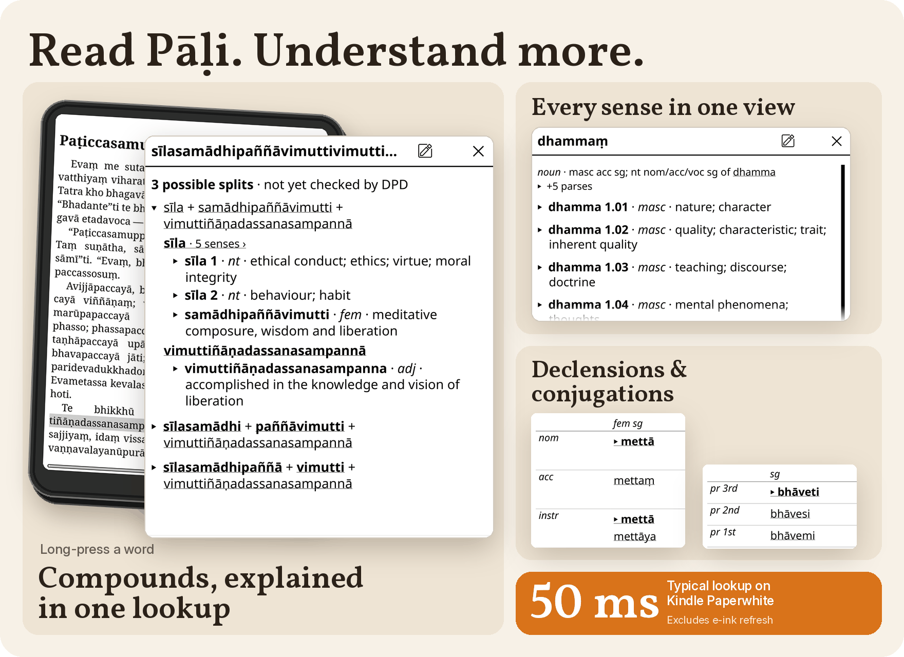
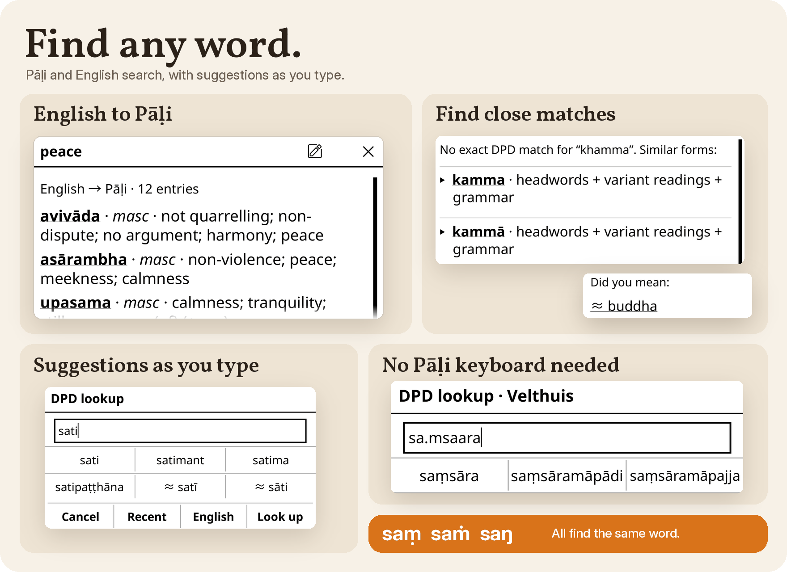
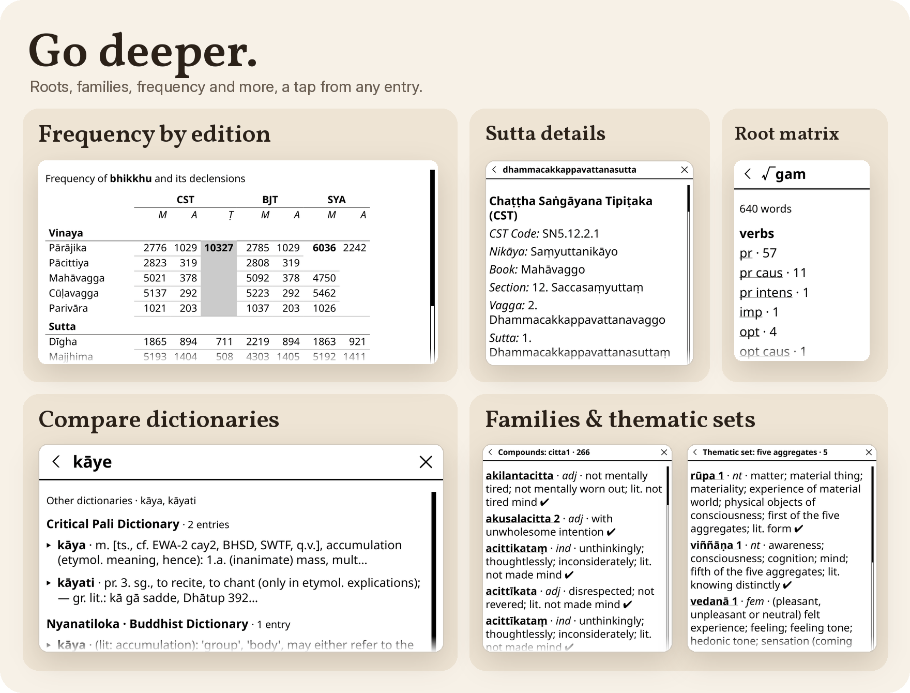

# Digital Pāḷi Dictionary for KOReader

[](https://github.com/digitalpalidictionary/dpd-koreader/releases/latest)

Long-press a Pāḷi word to see its meanings, grammar and compound parts without
leaving your book. This plugin brings the
[Digital Pāḷi Dictionary](https://www.dpdict.net/) (DPD) into KOReader.

**[Install](#install)** · [Using it](#using-it) · [User guide](docs/USAGE.md) · [Help](#troubleshooting)

<p align="center"><a href="docs/images/hero.png"><picture>
  <source media="(prefers-color-scheme: dark)" srcset="docs/images/hero-dark.png">
  
</picture></a></p>

## Highlights

- **Compounds, explained:** a long compound's parts and their meanings in
  one lookup, with alternative analyses a tap away.
- **Every sense in one view:** meanings in DPD's order, with grammar,
  examples and linked explanations.
- **Fast on Kindle:** about 50 ms a lookup on a Paperwhite, plus the e-ink
  refresh. See the [measurements and limits](docs/TESTING.md#kindle-results).
- **Search in Pāḷi or English:** labelled suggestions, optional diacritics
  and Velthuis keyboard input. See [search](docs/USAGE.md#look-up-a-word).

<p align="center"><a id="find-any-word" href="docs/images/find.png"><picture>
  <source media="(prefers-color-scheme: dark)" srcset="docs/images/find-dark.png">
  
</picture></a></p>

- **Explore further:** inflection tables, frequency, suttas, roots, word
  families and other dictionaries. See
  [entry views](docs/USAGE.md#more-from-an-entry).

<p align="center"><a id="go-deeper" href="docs/images/deeper.png"><picture>
  <source media="(prefers-color-scheme: dark)" srcset="docs/images/deeper-dark.png">
  
</picture></a></p>

## Install

You need **KOReader v2026.07 or newer** and about **1.1 GB of free space**.
The plugin is tested on Kindle Paperwhite, inkBOOK Solaris (Android), macOS
and Linux; KOReader also runs on Kobo and PocketBook.

1. **Plugin.** Download `dpd-koplugin-<version>.zip` from the
   [latest plugin release](https://github.com/digitalpalidictionary/dpd-koreader/releases/latest)
   and extract it into `koreader/plugins/`, so this file exists:

   ```
   koreader/plugins/dpd.koplugin/main.lua
   ```

2. **Database.** Download `dpd-mobile-db.zip` separately from the
   [official DPD releases](https://github.com/digitalpalidictionary/dpd-db/releases/latest)
   (about 200 MB). Extract it on your computer and copy `dpd-mobile.db`
   (about 1 GB) to:

   ```
   koreader/data/dpd/dpd-mobile.db
   ```

   Create `data/dpd` if needed. Keep the database **outside the plugin
   folder**. Its folder must be writable: DPD never modifies the database,
   but SQLite creates small `-wal` and `-shm` files beside it. This plugin
   was tested with DPD v0.4.20260926 (schema 7); newer releases work as long
   as **Database status** reports the core columns OK.

3. **Restart.** Eject the device and restart KOReader. If external plugins
   are disabled, enable them under **Plugin management** and restart again.

4. **Check.** Open **Search → Digital Pāḷi Dictionary → Database → Database
   status**. It should say **Database ready**. For a database elsewhere, use
   **Database → Choose database file** and long-press the `.db` file in its
   writable folder.

## Using it

- **Long-press a word:** DPD opens when it finds a match; otherwise your normal
  dictionary opens. For a long unrecorded Pāḷi word, DPD may offer the parts
  it recognises.
- **Tap ▸:** expand a sense or compound analysis. Tap underlined text to
  open another entry, then **Back** to return with your place kept.
- **KOReader dictionary:** opens the word in your usual dictionary.
- **Look up a word:** type a search from the DPD menu. Drag across a
  phrase in your book to use the selection menu's **DPD** button.
- **English books:** turn off **Open DPD on long-press in this book** if
  English words open DPD. Your normal dictionary still offers a **DPD** button.

For Pāḷi searches, diacritics and capitals are optional: `Buddha` finds `buddha`,
`nana` suggests ñāṇa, and `saṁ`, `saŋ` and `saṃ` all match. See
[everyday reading](docs/USAGE.md#everyday-reading) for more.

## Updating

**From 0.3.0 or earlier:** update manually once, using the steps below.
The in-app updater is new in 0.3.1.

- **Plugin:** open **Help → Check for updates** in the DPD menu, choose
  **Install**, then restart KOReader. To update manually, exit KOReader,
  delete `koreader/plugins/dpd.koplugin`, extract the new plugin folder in
  its place and restart. Settings and recent lookups are kept.
- **Database:** download and extract the new database separately. Exit
  KOReader, replace `dpd-mobile.db`, delete any `dpd-mobile.db-wal` and
  `dpd-mobile.db-shm` files beside it, then restart. Check **Database status**.

See [plugin updates](docs/USAGE.md#update-the-plugin) and
[database replacement](docs/USAGE.md#replace-the-database) for details.

## Troubleshooting

- **DPD never opens:** check **Database → Database status**, choose the
  extracted database with **Choose database file**, and check that external
  plugins are enabled.
- **A long-press picks only part of the word** (as with `bhikkhave’ti`):
  drag across the whole word, or type it in **Look up a word**.
- **DPD is missing after an update:** exit KOReader. If `koreader/plugins/`
  contains `dpd.koplugin.previous`, delete any `dpd.koplugin` folder and
  rename `dpd.koplugin.previous` to `dpd.koplugin`, then restart. Otherwise
  install the plugin zip manually.
- **Something crashed or looks wrong:** follow the
  [diagnostic and recovery steps](docs/USAGE.md#troubleshooting), then
  [report the problem](docs/TESTING.md#reporting-feedback). Logs can contain
  lookup words and book paths; remove anything private before posting.

## Uninstall

Exit KOReader, delete `koreader/plugins/dpd.koplugin` and restart. To remove
the database and diagnostic log too, delete `koreader/data/dpd/` (or the
database you chose elsewhere).

## Documentation

The download includes the [user guide](docs/USAGE.md) and
[testing and feedback](docs/TESTING.md), with links that work offline.

## Contributing

[Report an issue](https://github.com/digitalpalidictionary/dpd-koreader/issues)
or start with the
[developer guide](https://github.com/digitalpalidictionary/dpd-koreader/blob/main/docs/DEVELOPMENT.md)
and [KOReader test runbook](https://github.com/digitalpalidictionary/dpd-koreader/blob/main/docs/KOREADER_RUNBOOK.md).
KOReader only loads plugin folders whose names end in `.koplugin`, so clone
it under that name:

```sh
git clone https://github.com/digitalpalidictionary/dpd-koreader.git dpd.koplugin
```

## Licensing and attribution

Plugin code: [MIT](LICENSE). Digital Pāḷi Dictionary, © Bodhirasa Bhikkhu:
[CC BY-NC-SA 4.0](LICENSE-DPD), including dictionary material in screenshots
and examples. The database is downloaded separately. See [NOTICE](NOTICE)
for port permissions, screenshot provenance and other dictionary notices.
